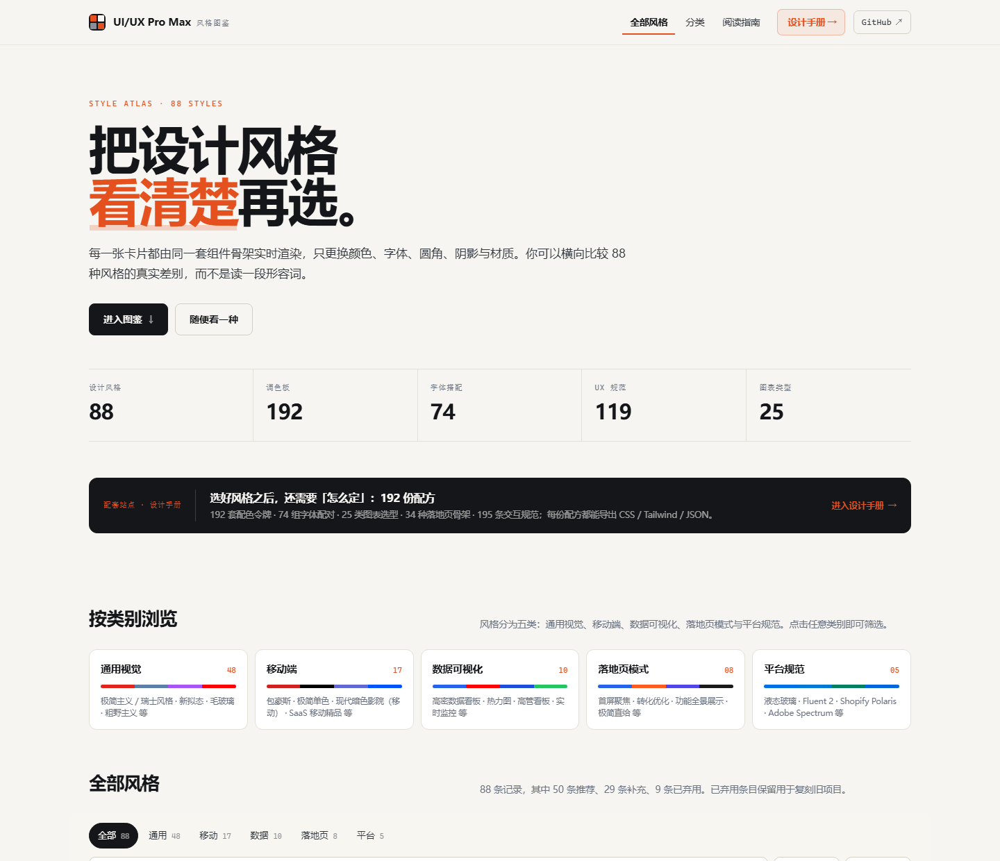
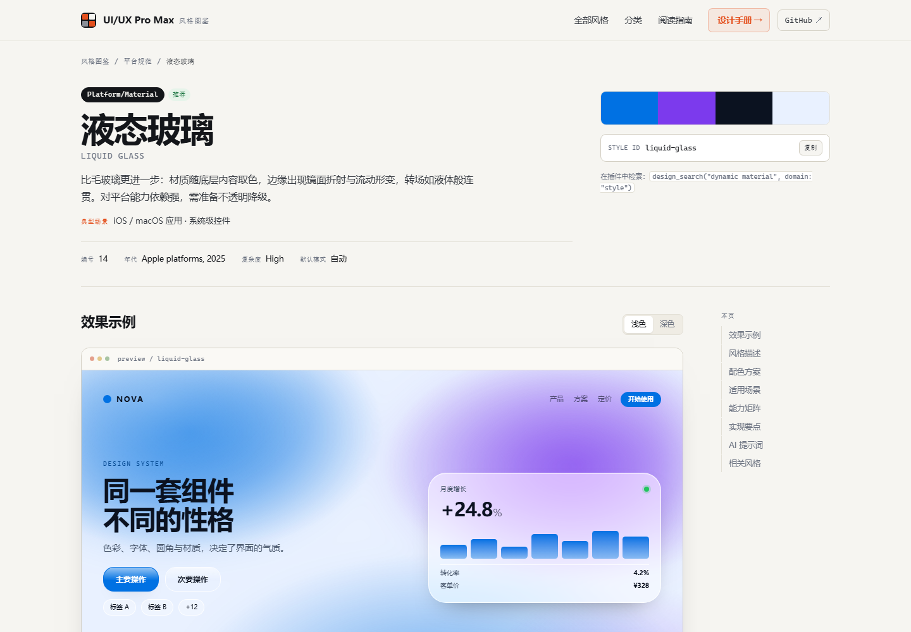
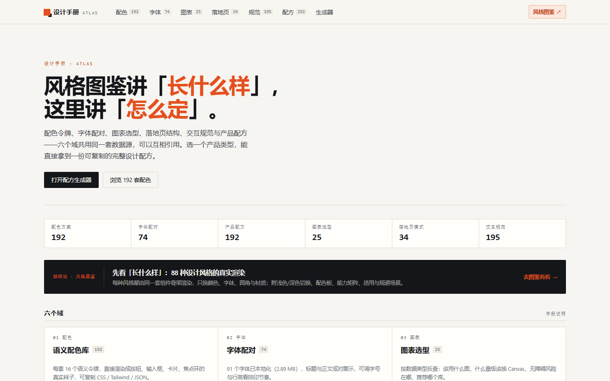
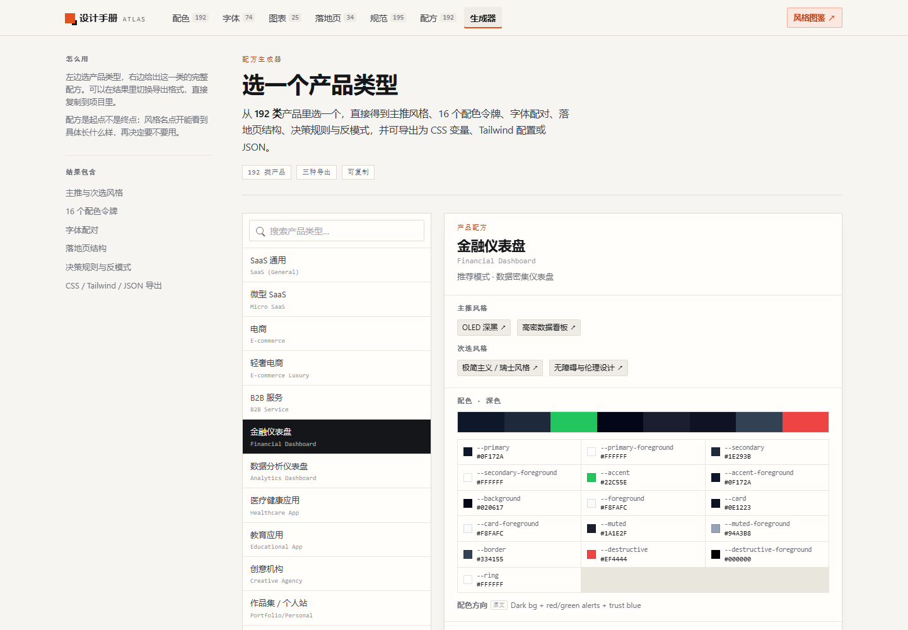

# dsh-ui-ux-pro-max

> DeepSeek Harness（DSH）的 UI/UX 设计智能库插件——内置 **88 种设计风格、192 个调色板、74 组字体搭配、195 条交互规范、25 种图表类型与 192 份产品配方**，完全离线、中文优先。
>
> 最直观的入口不是文档，而是两个在线站点：**[风格图鉴](https://chenyiming-aaa.github.io/dsh-ui-ux-pro-max/gallery/)** 与 **[设计手册](https://chenyiming-aaa.github.io/dsh-ui-ux-pro-max/handbook/)**。

<p align="center">
  
  
  
  
</p>

| 站点 | 一句话 | 打开 |
| --- | --- | --- |
| **风格图鉴** ★ | 88 种设计风格逐页真实渲染，可横向比较差异 | [chenyiming-aaa.github.io/…/gallery/](https://chenyiming-aaa.github.io/dsh-ui-ux-pro-max/gallery/) |
| **设计手册**（同一套数据的另一视图） | 配色 / 字体 / 图表 / 落地页 / 规范 / 配方六个域 | [chenyiming-aaa.github.io/…/handbook/](https://chenyiming-aaa.github.io/dsh-ui-ux-pro-max/handbook/) |
| 配方生成器 | 选一个产品类型，直接拿到完整设计配方 | [handbook/compose.html](https://chenyiming-aaa.github.io/dsh-ui-ux-pro-max/handbook/compose.html) |

## ★ 风格图鉴：把 88 种风格看清楚再选

<p align="center">
  <a href="https://chenyiming-aaa.github.io/dsh-ui-ux-pro-max/gallery/">
    
  </a>
</p>

**每一张卡片都由同一套组件骨架渲染**，只替换设计令牌与材质特效类——所以看到的是真实界面，而不是一段形容词。支持按类别筛选、关键词搜索、按编号 / 名称 / 复杂度排序，桌面与移动端都能用。

每个风格都有独立详情页。下面这页（[液态玻璃 ↗](https://chenyiming-aaa.github.io/dsh-ui-ux-pro-max/gallery/style/liquid-glass.html)）是最能体现渲染引擎的一页：磨砂层叠、边缘高光、折射动画，全部由 CSS 令牌与材质类产出。

<p align="center">
  <a href="https://chenyiming-aaa.github.io/dsh-ui-ux-pro-max/gallery/style/liquid-glass.html">
    
  </a>
</p>

一页之内包含：中文导读与英文原名、**可切换浅色 / 深色的实时预览**、配色板与 HEX、能力矩阵、适用与规避场景、落地清单、可复制的 AI 提示词、相关风格。88 个页面全部纯静态、零外部请求。

## 设计手册：同一套数据的另一视图

图鉴按「风格」翻，手册按「决策」翻——两者共用同一份 4319 行知识库，不是两个独立站点。选好风格之后，剩下的「怎么定」在这里。

<p align="center">
  <a href="https://chenyiming-aaa.github.io/dsh-ui-ux-pro-max/handbook/">
    
  </a>
</p>

| 域 | 内容 |
| --- | --- |
| 配色 | 192 套 × 16 个语义令牌，直接渲染成按钮 / 输入框 / 卡片 / 焦点环，附 7 组 WCAG 对比度与 CSS / Tailwind / JSON 导出 |
| 字体 | 74 组标题 + 正文配对，**91 个字族的 latin 子集已本地化（约 2.9 MB）**，看到的是真实排印 |
| 图表 | 25 类数据类型的选型表：最佳图表、备选、禁用条件、SVG/Canvas 阈值、无障碍风险 |
| 落地页 | 34 种页面骨架，把分区顺序画成线框并标出 CTA 与配色策略 |
| 规范 | 195 条 UX / React / Web 规范，「正确 / 错误」代码对照，按严重度筛选 |
| 配方 | 192 类产品：主推与次选风格、16 个令牌、字体、落地页、决策规则与反模式 |

**配方生成器**把三张表（product / color / reasoning）按产品类型同名同序对齐，选一个类型即得整份配方；192 个产品类型、88 种推荐模式、34 种落地页模式全部中文，中英文都能搜。764 处风格引用全部解析到图鉴详情页，没有悬空链接。

<p align="center">
  <a href="https://chenyiming-aaa.github.io/dsh-ui-ux-pro-max/handbook/compose.html">
    
  </a>
</p>

## 特性

- **三个工具**：生成设计系统、审查 UX、按领域或技术栈检索。
- **数据完全内置**：4319 行设计数据库随包发布，零网络、零 Python、零第三方运行时依赖。
- **中文优先**：全中文输出，400+ 中文术语映射 + CJK 二元分词；单字查询（`图` / `色` / `字` / `动`）按领域兜底。
- **设计旋钮**：`variance` 大胆度 / `motion` 动效强度（附 GSAP 方案）/ `density` 密度，均为 1-10。
- **纯 JavaScript**：BM25 检索引擎 + 设计系统生成器，Node `^22.19 || >=24`。

## 安装

三种方式任选其一。当前版本 **1.4.1**；以 [npm 包页](https://www.npmjs.com/package/dsh-ui-ux-pro-max) 实际发布的版本为准。

### 从插件市场 / npm

```powershell
dsh plugin --profile desktop add --save-exact dsh-ui-ux-pro-max@1.4.1
dsh plugin --profile web     add --save-exact dsh-ui-ux-pro-max@1.4.1
```

> DSH Desktop 不把 `dsh` 加入 PATH，安装后请新开一个终端；若仍提示找不到命令，先执行 `npm install -g @deepseek-ai/dsh`。

### 从源码安装（Windows）

```powershell
git clone https://github.com/ChenYiming-aaa/dsh-ui-ux-pro-max.git
cd dsh-ui-ux-pro-max
powershell -ExecutionPolicy Bypass -File .\install.ps1
```

脚本会按 `package.json` 的 `files[]` 白名单复制文件到 profile 的共享 `node_modules`，并幂等追加注册条目；支持 `-ProfileDir` / `-ProfileName`，`-WhatIf` 可先预览。

### 手动安装（任意平台）

把包放入 `<profile>\..\node_modules\dsh-ui-ux-pro-max\`，然后在 profile 的 `cordis.patch.yml` 追加：

```yaml
- insert:
    - id: ui-ux-pro-max
      name: dsh-ui-ux-pro-max
      config: {}
```

重启 DSH Desktop，或运行 `npx @deepseek-ai/dsh web`。

安装完成后可以问一句「推荐一个金融数据看板的设计风格」来验证工具是否生效。

## 使用方法

### 三个工具

| 工具 | 用途 | 主要参数 |
|---|---|---|
| `design_recommend` | 产品类型 + 关键词 → 完整设计系统：风格优先级、HEX 配色与 CSS 变量、字体搭配、落地页模式、UX 要点、反模式、旋钮 | `query`（必填）、`projectName`、`stack`、`variance`、`motion`、`density` |
| `design_review` | 按 UX + 移动端 + React 性能规范审查 UI，按严重度排序，附交付前检查清单 | `target`（必填）、`platform`、`maxRules` |
| `design_search` | 按领域或技术栈检索设计知识；可选 `includeDeprecated` 包含废弃条目 | `query`（必填）、`domain`、`stack`、`maxResults`、`includeDeprecated` |

`design_search` 的 `domain` 可选值：`style` / `color` / `chart` / `landing` / `product` / `ux` / `typography` / `icons` / `gsap` / `react` / `web` / `google-fonts`；`stack` 为 22 个技术栈之一（如 `react`、`nextjs`、`vue`、`flutter`、`swiftui`、`javafx`），与 `domain` 二选一。

`design_review` 的 `platform` 可选 `web`（默认）/ `mobile` / `desktop` / `react-native` / `flutter`。它只影响**同严重度内**的排序：匹配平台的规则优先，不匹配的降权保留而非过滤；`react-native` 与 `flutter` 会额外附加该技术栈的规范。

### 常见用法

按「你正在做什么」选工具，参数写手头真实的信息：

```text
# 新项目：先拿一整套方案
design_recommend("财务 数据看板 深色 高密度", projectName: "财务中台", stack: "react")

# 改版评审：页面和问题现象一起说
design_review("移动端登录页，提交后没有任何反馈", platform: "mobile")

# 只缺某一块：按领域定点补
design_search("毛玻璃 深色", domain: "style")
design_search("金融 信任蓝", domain: "color")
```

中文直接写中文（「金融」会映射到 fintech）；但 `gsap` / `react` / `web` / `google-fonts` 的语料是英文，保留术语命中更准（`scroll reveal`、`memo`）。

### 设计旋钮

三个旋钮都是 1-10 的整数，不传则使用风格自带的默认值：

| 旋钮 | 1 | 10 | 附带效果 |
|---|---|---|---|
| `variance` | 居中、极简、对称 | 大胆、不对称、强对比 | 影响风格与布局建议 |
| `motion` | 克制 | 复杂编排 | 高值附 GSAP 动效片段 |
| `density` | 宽松 | 紧凑、看板化 | 覆盖间距刻度（spacing scale） |

### 内置数据

| 类别 | 内容 |
|---|---|
| 设计素材 | 风格 **88** · 调色板 **192** · 字体搭配 **74** · 图表 **25** · 落地页模式 **34** |
| 组件与动效 | 图标 **105** · GSAP 动效 **17** |
| 审查规范 | UX 规范 **119** · React 性能 **44** · 移动端接口 **32** · 推理规则 **192** |
| 检索支撑 | 产品类型 **192** · 技术栈 **22** · Google 字体 **1934**（懒加载） |

88 种风格中有 9 条标记为 `deprecated`，默认不参与检索（实际可检索 79 条）。风格与技术栈的废弃条目采用同一策略：默认排除，查询中显式包含 `legacy` / `deprecated` 时保留，便于复刻旧项目。

数据移植自 `nextlevelbuilder/ui-ux-pro-max-skill@56ea9cf`（2026-10-15）。

## 站点的构建与部署

两个站是同级目录 `gallery/` 与 `handbook/`，站点根 `index.html` 跳转到 `/gallery/`。同级布局让本地双击 html 打开与线上部署的相对路径完全一致，`../handbook/` 这类互链在两种场景下都成立。手册**单独构建、单独成站**，只依赖 `tools/atlas/`、`data/`、`assets/atlas-fonts/`。

```bash
npm run fonts             # 首次或换字体时：下载 91 个字族的 latin 子集
npm run build             # 两站一起构建（= build:gallery + build:handbook）
npm run build:gallery     # 只构建图鉴 → gallery/
npm run build:handbook    # 只构建手册 → handbook/
npm run serve             # 两站预览：/gallery/ 与 /handbook/
npm run serve:gallery     # 只跑图鉴，挂在根路径
```

推送到 `main` 后 `.github/workflows/pages.yml` 会重建两站、跑两份结构检查，再合并成一个 Pages 产物发布（仓库 Pages 的 Source 为「GitHub Actions」）。中文名称、导读与预览主题在 `tools/showcase/theme-data.mjs`，手册的数据派生在 `tools/atlas/data.mjs`。

## 配置

插件只有三个配置项，写在注册条目的 `config` 里，全部可省略：

```yaml
- insert:
    - id: ui-ux-pro-max
      name: dsh-ui-ux-pro-max
      config:
        maxResults: 3      # design_search 未传 maxResults 时的默认条数，1-8
        reviewRules: 8     # design_review 未传 maxRules 时的默认条数，1-20
        skill: true        # 是否注册内置 ui-ux-pro-max 技能
```

| 配置项 | 类型 | 默认值 | 取值范围 | 说明 |
|---|---|---|---|---|
| `maxResults` | 整数 | `3` | 1-8 | `design_search` 的默认返回条数；调用时传参可覆盖 |
| `reviewRules` | 整数 | `8` | 1-20 | `design_review` 的默认规范条数；调用时传参可覆盖 |
| `skill` | 布尔 | `true` | `true` / `false` | 设为 `false` 时只注册三个工具，不注册技能 |

未知字段会被忽略；类型或范围不合法时插件在加载期报错，不会带病启动。

## 常见问题

**安装后工具或技能没有出现？**
依次检查：`dsh` 命令是否指向正确的 profile；profile 的 `cordis.patch.yml` 是否有 `id: ui-ux-pro-max` 的 `insert` 条目；Node 版本是否满足 `^22.19 || >=24`；修改后是否重启了 DSH。

**npm 上的版本比仓库旧？**
直接指定已发布版本安装，或改用源码安装：

```powershell
dsh plugin --profile desktop add dsh-ui-ux-pro-max@1.4.1
```

**需要联网吗？**
不需要。数据全部随包内置，Google 字体列表也是本地文件，插件运行时不发起任何请求；两个站点同样零外部请求。

**为什么搜不到某些风格？**
它们可能被标记为 `deprecated` 并默认排除。在查询里带上 `legacy` 或 `deprecated` 即可召回。

**中文单字查询（`图` / `色` / `字` / `动`）结果不理想？**
单字信息量不足，插件会先把已登记的单字映射到对应领域；若扩展后仍无命中，则返回该领域的默认条目并标记 `fallback`。换成具体词组效果更好，例如「金融 配色」「图表 对比」。

**支持哪些 DSH 版本？**
覆盖 0.1.0 / 0.1.1 / 0.2.0 / 0.2.1 四条预发布线及其正式版（上界 `<0.3.0-0`）。已在 0.1.1-rc.1、0.2.0-rc.2、0.2.1-rc.2 验证工具定义、执行、输出 schema、渲染与技能注册。详见 [DSH-COMPAT.md](https://github.com/ChenYiming-aaa/dsh-ui-ux-pro-max/blob/main/docs/DSH-COMPAT.md)。

**可以替换或扩充数据吗？**
数据在 `data/index.json` 与 `data/fonts.json`，随包发布；目前不支持运行时加载外部数据文件，需要修改后重新打包。

**只装插件、不装技能可以吗？**
可以，把配置里的 `skill` 设为 `false`，三个模型工具仍然可用。

## 致谢与许可证

数据与算法移植自 [nextlevelbuilder/ui-ux-pro-max-skill](https://github.com/nextlevelbuilder/ui-ux-pro-max-skill)（MIT），针对 DSH 插件形态重写为纯 JS、离线、中文优先。第三方来源详见 [THIRD_PARTY_NOTICES.md](THIRD_PARTY_NOTICES.md)。

[MIT](LICENSE) © ChenYiming-aaa。
